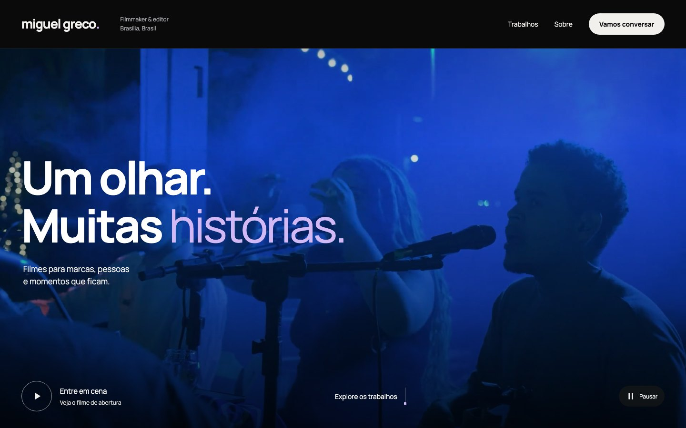
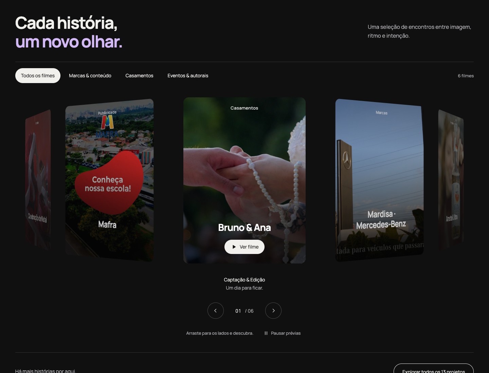
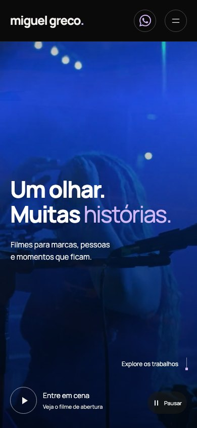
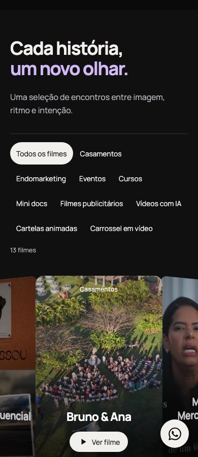

# Miguel Greco — Audiovisual Portfolio

A cinematic portfolio for filmmaker and editor Miguel Greco, built with React and Vite. Real films, editorial typography, a circular project carousel, and direct WhatsApp contact bring the work to the foreground.

The website content is in Brazilian Portuguese. This README documents the project in English.

## Screenshots

### Desktop

**Opening film**

**Circular film collection**

Explore films in a perspective carousel with silent previews, including the visible side cards.

### Mobile

  
  

Screenshots show actual browser renders. The opening video's frame changes during playback.

## Features

- Muted opening video with play and pause controls and reduced-motion support.
- A circular 3D carousel with drag, keyboard and button navigation, all 13 original projects available immediately.
- Seven-second silent previews for 12 films and the personal Polaroid, with visible side-card playback and pause controls.
- Filters matching the original portfolio: weddings, endomarketing, events, courses, mini documentaries, advertising films, AI videos, animated title cards and video carousels.
- Individual film pages with participation credits, Google Drive playback, and original-file links.
- A personal video presented as a Polaroid that straightens on entry. A silent preview plays in view; the main play button opens the complete video with sound and native controls. An airplane-photo poster remains beneath the preview.
- A responsive dotted journey connecting the biography heading to the Polaroid, with travel and audiovisual symbols that progressively turn light purple while scrolling.
- WhatsApp links in the mobile header, navigation, contact section, and floating shortcut.
- An optional briefing form that prepares a WhatsApp message for the visitor to review and send.
- Responsive layouts, keyboard focus states, and self-hosted Manrope fonts.

## Tech Stack

- React 19
- Vite 7
- CSS with responsive layouts and SVG graphics
- Static hosting; no application server is required

## Getting Started

Use Node.js **22.12 or later** and npm.

~~~sh
npm ci
npm run dev
~~~

Open the local URL printed by Vite.

## Production Build

~~~sh
npm run build
~~~

The generated website is written to `dist/`.

To preview the production build locally:

~~~sh
npm run preview
~~~

## Deploy to Netlify

Import this GitHub repository into Netlify and use:

- **Production branch:** `main`
- **Build command:** `npm run build`
- **Publish directory:** `dist`

For a manual deployment, run the production build and upload the `dist/` folder to Netlify Drop.

## Updating the Portfolio

- **Projects and credits:** edit [`src/projects.js`](src/projects.js).
- **Page copy, the initial selection, and components:** edit [`src/main.jsx`](src/main.jsx).
- **Layout and appearance:** edit [`src/styles.css`](src/styles.css).
- **Cover images, videos, and fonts:** place assets in [`public/assets/`](public/assets/).

Film URLs use hash navigation, such as `#filme/bruno-e-ana`.

Portfolio updates are maintained in the source code; a publishing CMS is not included. The briefing form prepares a WhatsApp link and does not submit messages or store visitor details on an application server.

## Media and Design References

Media sources are recorded in [`ASSET-SOURCES.json`](ASSET-SOURCES.json). Existing film credits and source links come from [Miguel's original portfolio](https://lemu.re/p/Miguel.Greco.Visual/).

The design system is documented in [`DESIGN.md`](DESIGN.md), and product context is recorded in [`PRODUCT.md`](PRODUCT.md).

Manrope is bundled with its [SIL Open Font License](public/assets/Manrope-OFL.txt). The WhatsApp brand glyph comes from [Simple Icons](https://simpleicons.org/).
